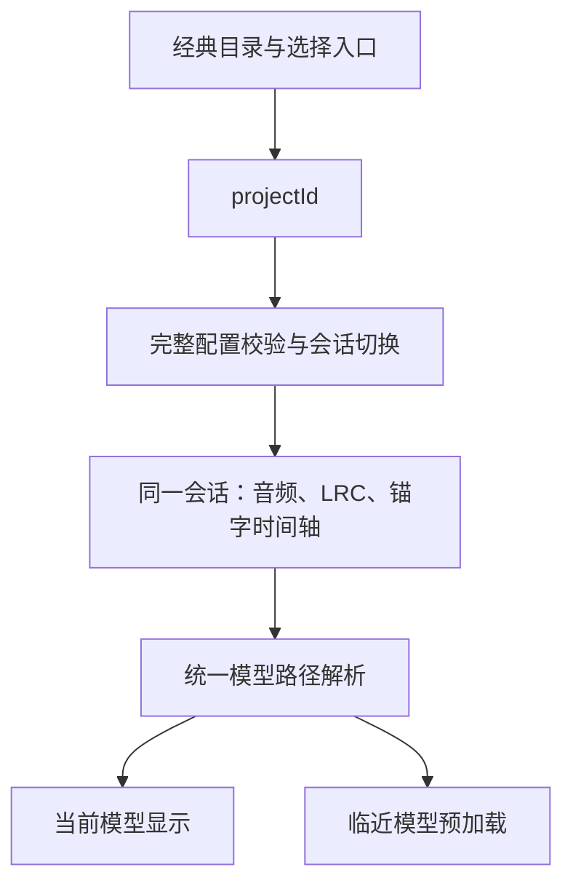

# CoScroll 工程经验与多经典接入规范

规范版本：1.0；整理日期：2026-10-21。

适用范围：在现有「经文竖排 + 锚字玉质模型 + 音频同步 + 无限滚动」体验中接入更多经典，
并把现有字模型库扩展到百字规模。普通经文使用字体显示，3D 模型覆盖选出的锚字，
不要求经文中的每个字都有模型。

本文区分三类内容：**现状**是已核对的实现或测试事实；**接入要求**是后续交付需要满足的约束；
**待实现设计**是建议补齐的模块，不表示功能已经存在，也不表示已完成实现方案确认。

2026-10-22 补充：[曲目切换、画面设置与模型占位方案](PLAYBACK_APPEARANCE_MODEL_PLAN.md)
记录了 101 个源模型的盘点、明确占位、切歌、背景 shader 与统一调色的具体草案，仍须确认后实施。

## 1. 当前可用基线与边界

基线代码为 `f166e86`，发布版本为 `coscroll-c274344445eb3147`，入口为
[tongye.me/coscroll/](https://tongye.me/coscroll/) 和
[aitoshuu.me/coscroll/](https://aitoshuu.me/coscroll/)。
详细证据见[无限滚动与正文性能回归](CONTINUOUS_SCROLL_RELEASE_20261021.md)。

| 项目 | 现状 | 后续接入的含义 |
| --- | --- | --- |
| 公开使用 | 《心经》播放、暂停、拖动、滚轮、键盘、双向无限滚动及原生音频循环已验证 | 可以复用体验底座 |
| 内容配置 | 主入口固定调用 `loadProject('heart-sutra')`，当前只有一个项目 JSON | 还需经典目录与选择入口 |
| 模型资产 | 当前目录有 26 个 OBJ，已有完整几何预计算流程 | 用户另有的百字模型尚未入库验收 |
| 模型映射 | 页面根据配置预加载，实际显示组件仍保留另一份固定字表 | 新字映射必须打通到最后的显示端 |
| 文字资源 | 默认 13 列窗口，闲置纹理限制为 8 项且约 12 MiB | 已避免随滚动轮数无限增加文字资源 |
| 模型资源 | 当前/下一个模型按需加载，但访问过的几何缓存没有容量上限 | 百字与多经典使用前需补回收策略 |
| 手机性能 | ego-lite 手机模拟正常/压力各 60 秒约 31.88/29.42 FPS，未复现 1 秒停顿 | 不是手机真机性能承诺；平均提速未获稳定证明 |
| 前后台 | 受控可见性事件及延迟播放 Promise 回归通过 | 实际手机后台、锁屏与系统挂起尚未验证 |

“当前《心经》可用”“可以扩展更多经典”“百字库已验收”是不同结论，须分别记录。

## 2. 视觉与交互保持规范

新增经典默认继承当前效果，不能把接入内容变成未经确认的视觉改版。

| 保持项 | 当前基线 |
| --- | --- |
| 经文排版 | 竖排、上下错落、横向移动；空白时间行也参与列序与交替关系 |
| 前后层次 | 前景经文、中央玉字、后景经文的深度与遮挡关系，保留深度测试和既有绘制顺序 |
| 字号与比例 | 前后经文目前为同字号；玉字与经文比例、列距和上下位置沿用现有参数 |
| 相机 | 正交相机；不具有自动“近大远小”的透视缩放，若要引入需另行设计 |
| 材质与背景 | 玉石双层、透射、完整模型、丝绸 shader、文字透明度与边缘羽化 |
| 画布与清晰度 | 保留两个画布、原有 DPR 策略与完整字体，不通过降低画质冒充等效优化 |
| 手势 | 保留触摸、鼠标拖动、双轴滚轮、进度条、键盘及播放/暂停行为 |

参数以 [UnifiedLyricsAndModel](../src/components/layouts/UnifiedLyricsAndModel.tsx) 和
[分层布局计算](../src/components/layouts/layeredLyrics.ts)为准。
手机 390 × 844、DPR 2 的参考画布为背景 780 × 1688、正文 702 × 1288。
既有同姿态对照中背景像素完全一致，正文超过 99.998% 像素一致；该数字只代表已测固定场景。

新经典必须检查长句在窄屏中的完整呈现。当前竖排文字不会按屏高自动拆列。
需要分句时按语义与录音重新标时间；不能通过静默裁切、删字或任意缩小字号掩盖溢出。

## 3. 已验证的工程经验

| 经验 | 已发现的问题或证据 | 后续实现要求 |
| --- | --- | --- |
| 结束状态必须发布 | 旧速度衰减到 0 后未更新 React，暂停 7 秒时歌词可漂到约 247 秒 | 手势结束与最终零值必须可观察；暂停后清除惯性残留 |
| 最新定位优先 | 旧滚轮定时器可把新的 25 秒定位覆盖回 22 秒 | 新命令取消旧预览、定时器和排队请求；保留原始目标，避免浮点重组造成误拒绝 |
| 媒体时钟是播放依据 | 用墙钟外推或恢复隐藏前的时间可能漂移、回退 | 播放/回前台采样实际媒体时钟；预览与提交状态分开 |
| 循环观察不等于 seek | 新轮次配上旧相位曾触发错误重定位 | 明确区分用户命令与媒体观察值；原生循环不附加逐轮 JS seek |
| 有限窗口配稳定身份 | 重建整窗会重复生成和上传文字 | 逐帧位置、颜色、透明度和羽化在渲染循环更新，React 处理窗口或内容变化 |
| 缓存需管理所有权 | 并发渲染与提前淘汰可产生无主资源或失效引用 | 提交时获取并持有资源；活跃资源固定持有，闲置资源按数量和字节回收 |
| 完整几何也能预计算 | 手机现场解析、合并顶点、生成外层会增加切换工作 | 将原完整算法离线执行，保留全精度数据和原算法回退，不减面、不量化 |
| 离屏不等于没有成本 | 高竖排文字的包围球会让零像素贡献的平面继续绘制 | 只保守剔除完全位于视口外的矩形，保持余量与原可见像素 |
| 优化需要对照 | R32F 静态噪声缓存像素相符，但无稳定 GPU 收益并增加约 5.3 MB 数据 | 实验同时检查画面、耗时和内存；不满足条件的尝试撤回 |
| 帧率需分层归因 | 971 ms 长帧中约 946.5 ms 为 CPU idle，独立简单动画也约 30 FPS | 同时记录 JS、GPU、帧间隔、加载与环境对照，不仅凭 FPS 判断项目瓶颈 |

文字纹理的 12 MiB 是**闲置缓存估算预算**，不包括全部活跃纹理、模型和渲染目标，
不得写成“整个应用只占 12 MiB”。播放时约每秒 4 次的界面更新，也不能与暂停后的错误持续更新混为一谈。

## 4. 每部经典的内容交付规范

### 4.1 素材与配置

每部经典或独立分卷采用稳定的 `project.id`，建议使用小写英文与连字符，文件名与 ID 一致。
同一经本的不同录音版本需要可区分的 ID 或明确版本记录，不能直接复用另一录音的时间轴。

| 材料 | 必需内容 |
| --- | --- |
| 经本信息 | 显示名称、经本/分卷、文本版本、繁简与异体选择；写入描述或配套接入记录 |
| 完整配置 | `public/projects/<id>.json`，使用现有 `ProjectConfig`，保留全部必填结构 |
| 音频 | 与时间轴对应的实际录音，优先沿用已验证的 MP3 路径；其他格式需验证浏览器和分段请求 |
| 经文时间轴 | UTF-8 LRC，一行一个带时间戳的显示段，覆盖完整经文 |
| 锚字时间轴 | `timeline` 中的秒数、锚字、对应经文及必要的语义说明 |
| 字模型映射 | 每个锚字解析到确定的模型文件，含明确的初始模型和缺字处理 |
| 字体覆盖 | 按实际全文检查字形；完整 8106 字形字体不等于覆盖任意 Unicode 字符 |

现有类型与结构校验见 [types.ts](../src/config/types.ts)、[schema.ts](../src/config/schema.ts)。
当前加载器**不会把缺少的必填字段自动与默认配置合并**；默认回退是另一套完整配置。
因此应复制完整的 [heart-sutra.json](../public/projects/heart-sutra.json) 再更改内容，
而不是把下列字段片段直接当成完整 JSON 交付。

以下是复制完整配置后需要替换的字段示例；保留模板的 `version`、完整 `theme` 和 `performance`：

```json
{
  "project": { "id": "classic-example", "name": "经典示例", "description": "填写经本与录音版本" },
  "assets": {
    "audio": { "src": "/audio/classic-example.mp3", "format": "mp3", "title": "经典示例" },
    "lyrics": { "src": "/lyrics/classic-example.lrc", "format": "lrc", "encoding": "utf-8" },
    "models": { "directory": "/models/10k_obj", "format": "obj" }
  },
  "anchors": {
    "mappings": [
      { "anchor": "心", "modelPath": "002_心.obj" },
      { "anchor": "空", "modelPath": "001_空.obj" }
    ],
    "defaultModel": "002_心.obj"
  },
  "timeline": [
    { "time": 3.2, "anchor": "心", "text": "第一句经文" },
    { "time": 10.5, "anchor": "空", "text": "第二句经文" }
  ]
}
```

这是格式示例，音频、LRC 和经典名称为占位值，不是已接入的新经典。
配置中使用逻辑路径，由 `assetUrl` 解析发布地址；不把某次 COS/CDN 的发布前缀硬编码进经书配置。
`models.directory` 负责目录，`modelPath/defaultModel` 使用文件名，避免重复拼接目录。

### 4.2 经文、时间与缺字

- 当前 LRC 解析器接受 `[mm:ss.xx]` 或 `[mm:ss.xxx]`，每行一个时间戳；例如：

  ```lrc
  [00:00.00]
  [00:03.20]第一句经文
  [00:10.50]第二句经文
  ```

- 当前分钟仅匹配两位数字，不能直接假定支持 `[100:00.00]`、小时格式或一行多个时间戳。
  超长录音需分卷/分段，或先确认并实现解析扩展。
- 接入检查还需确认秒字段在 00–59 之间、小数位正确；当前解析器不能代替完整的时间格式校验。
- 所有显示段和锚点时间都必须落在实际录音范围内。交付规范要求时间明确排序并处理重复时间，
  当前 Zod 仅保证锚点时间非递减，不会自动完成全部语义检查。
- 显示经文和锚字时间轴应按同一录音核对。允许艺术性提前或延后，但必须说明并验收；
  不能把当前《心经》两份时间值默认视为逐项相同，也不能把“滚动同步通过”当作“经文标注全部正确”。
- 最终循环时长以媒体元数据为准。当前《心经》配置仍写 364 秒，已测媒体实际约 374.256327 秒，
  新经典不得复制这个估计值作为硬性循环边界。
- 空白时间行会影响显示列的奇偶与上下排布，不得在清洗文本时无条件删除。
- 繁简、异体及模型字形对应关系必须明确；不能无记录地把不同字形互换。缺失字形应解决或明确记录，
  不能把系统字体的静默回退当作书法风格验收通过。
- 正式接入前检查每个锚点都有映射、每个映射都指向存在且完整的模型。现有“圆→空”等兼容占位
  不能视为新经典的完整字形覆盖；缺字预览与正式内容应有明确区别。

## 5. 百字模型入库与资源规范

### 5.1 单字检查

按字建立可追踪清单：字形、文件名、版本、Mesh 数、顶点/三角形数、包围盒、中心、朝向、
法线/UV、文件大小、源文件摘要、预计算产物摘要及验收结果。清单是接入记录要求，
不代表当前已有对应的运行时模型目录功能。

1. 保留完整笔画和原始精度。尺寸、中心与朝向要符合现有展示坐标，当前主页关闭 `fitToView`，
   且没有配置化的逐字缩放接口，不能假定大小不同的文件会自动适配。
2. **先检查多 Mesh 完整性。** 当前 OBJ 加载及预计算遍历保留最后一个 Mesh 的历史行为，
   若新文件按笔画分多个 Mesh，可能只显示局部。入库前需无损合并完整字，或先设计并验证完整多 Mesh 支持。
3. 检查正反面、法线、UV 及玉质材质下的表现。模型用于提供几何，原 MTL 外观不能直接视为最终效果。
4. 同一字的不同版本不得在未对照时覆盖。原始素材、处理方式和发布产物应能对应。
5. 现有完整预计算覆盖 OBJ；加载器的 GLB/GLTF 回退支持不等于这两类格式已具备同样的离线预计算流程。

### 5.2 完整几何预计算

现有工具读取 `public/models/10k_obj/` 并生成 `public/models/prepared/` 与内部注册表：

```sh
npm run models:prepare
npm run models:check
```

`models:prepare` 会重建注册表并清理不在源模型集合中的预计算文件，应在素材范围已确定后执行。
`10k_obj` 是既有目录名称，不表示允许自动减面到某个数量。

预计算必须复用现有完整处理算法，验证基础/外层的属性、索引及完整性摘要；
核对结果应有已确认算法或独立参考依据，不能仅让同一段生成代码自我比较。
默认几何参数为 `outerOffset=.001`、`maxEdge=.15`、`subdivisions=0`、`creaseAngle=30`、平滑着色开启。
自定义参数或资源失败的回退路径也要验证，不把可解压等同于画面正确。

### 5.3 百字规模的缓存要求（待实现）

- 只渲染当前模型，按需准备临近模型，不在首屏同时加载或绘制百字库。
- 下载、解压和 GPU 准备需有并发限制，取消或忽略过时的预加载；不能仅在 JSON 写入并发参数就假定已生效。
- 模型缓存单独设定容量和字节预算；文字纹理已有上限，不代表模型也有上限。
  具体模型预算需用实际百字素材与目标手机确定，上线验收前必须记录。
- 当前模型、已被可见场景引用的外层几何等不能被淘汰；闲置模型可按使用顺序回收。
  基础几何、外层几何与 GPU 资源的所有权和释放必须一致。
- 切经典或淘汰缓存时防止旧下载、旧解压结果重新写入已失效会话。当前 `clearCache()`
  只清 Map，没有完整的资源释放与异步代次保护，不能直接当作上述安全回收策略。
- 验证“库中数量”“已访问并缓存数量”“场景中实际绘制数量”三个指标，不能只观察一个 Map 的长度。

## 6. 多经典加载模块与切换规范（待实现设计）

### 6.1 单一数据来源



| 模块 | 必须负责的行为 | 当前需要补齐之处 |
| --- | --- | --- |
| 经典目录/选择 | 提供可用 ID、名称、录音版本与加载结果；具体 URL 方案需实施前确认 | 当前主入口固定《心经》 |
| 配置加载 | 校验请求 ID 与返回配置一致，验证所有引用 | 当前失败可回退《心经》，仍把请求 ID 记为成功 |
| 模型路径解析 | 配置生成一份权威映射，显示和预加载使用同一解析结果 | 当前两端字表来源不一致 |
| 播放会话 | 统一切换音频、经文、锚点、轮次、预览与待处理 seek | 尚无完整多经典切换流程 |
| 资源所有权/缓存 | 保护正在使用的数据、限制闲置资源、处理晚到异步结果 | 模型尚无容量与字节回收机制 |

现有几何预计算注册表不是经典目录，也不是锚字映射表。把模型文件加入注册表，
并不会自动让显示组件认识新锚字。主题、性能等 JSON 字段同样需追踪到最终消费端后才能宣称生效。

### 6.2 切换事务与失败行为

后续方案至少满足以下约束，具体状态与内部接口实施前确认：

1. 每次切换有可识别的会话代次。A→B→C 快速切换时，仅最新请求可提交内容。
   当前配置与 LRC 异步加载尚无完整的这类保护。
2. 准备并校验目标配置、音频元数据、经文与初始模型，避免出现 B 音频配 A 经文、旧模型覆盖新锚字。
3. 切换边界重置绝对时间、轮次、预览、速度、待处理 seek 和旧手势定时器；播放意图明确且可取消。
   新经典的进入/自动播放方式属于需确认的产品决定。
4. 找不到配置、模型或音频时保留可用状态或明确失败。不能把默认《心经》无提示地作为另一个 ID 的成功结果。
5. 同经典重新加载、切回已访问经典、后台返回、用户在加载中暂停等情形都使用同一套会话规则。
6. 保持现有回调和配置的兼容性；需新增字段、路径或接口时先更新类型、运行时校验及迁移说明。

## 7. 无限滚动与时间轴约束

- 内部保持有符号绝对时间 `t`。对于实际时长 `D>0`，轮次为 `floor(t/D)`，相位在 `[0,D)`；
  负时间不能用向零截断计算轮次。数值处理复用 [loopTimeline](../src/utils/loopTimeline.ts)。
- 进度条选择当前轮次内的相位；Home 定位当前轮起点，End 定位当前轮终点；左右键可继续跨过首尾。
- 触摸、鼠标和滚轮可以一次移动多轮；最新定位不能被旧手势、节流或异步回调覆盖。
  手势预览可先行，提交完成后媒体、进度与经文必须恢复一致。
- 不通过追加 DOM、歌词数组或新的场景对象实现“无限”。默认可见窗口有限，位置按相对偏移计算，
  轮数增加不能造成资源线性增长或巨大坐标精度丢失。
- 音频自然循环与显式 seek 分开；循环边界、暂停恢复、负轮次与第一句非零时间戳必须覆盖测试。

## 8. 每部新经典的验收与发布

### 8.1 接入验收

| 检查组 | 验收内容 |
| --- | --- |
| 内容与引用 | 经本/录音版本一致；配置结构通过；ID 一致；经文完整；时间范围、重复点、锚字和文件引用检查通过 |
| 字形与模型 | 字体覆盖；无静默异体替换；完整笔画；多 Mesh、尺寸/朝向、法线、UV 与材质检查通过 |
| 视觉 | 桌面、390 × 844、360 × 800；首句、长句、末句、空白间隔；同模型至少三个角度；保留原比例与遮挡 |
| 交互 | 全部手势、进度条、键盘、播放/暂停；快速 seek；反向跨零；大幅正反多轮移动；负轮次内进度定位 |
| 自然循环 | 至少 3 个完整循环，检查轮次、衔接与额外 JS seek；可用加速仅检查循环/资源，随后恢复 1 倍速 |
| 多经典切换 | A→B→C、快速切回、加载失败、加载中暂停；无旧音频、旧文字或旧模型回写 |
| 资源稳定 | 同经典多轮与多经典来回访问；统计基础/外层几何、纹理、内存与请求；达到预算后不持续增长 |
| 性能 | ego-lite 正常/压力各 60 秒的 1 倍速播放；区分首访加载和已加载阶段；记录长帧、长任务与资源切换 |
| 真机/后台 | 目标 iOS/Android 设备、实际后台/锁屏返回；不可用时明确记为未验证，不以受控事件替代真机结论 |

性能报告必须记录设备、视口、DPR、CPU/网络限制、缓存与预热状态、样本时长、平均 FPS、
帧耗时分布、最长帧和 JS 长任务。不得用短暂高帧率片段代表全程，也不得把 GPU 调用时间当整帧时间。
出现超过 500 ms、尤其约 1 秒的停顿时，要记录加载、JS、GPU和调度归因；
项目引起的必需问题未解决时，不能标记验收完成。环境对照与未验证项单列。

画面对照需固定时间、姿态、字体就绪状态与尺寸，不能通过强制旧网格可见性掩盖新剔除逻辑。
暂停、准备任务完成、无交互的稳定窗口，应没有错误的持续歌词漂移或逐帧纹理重建。

### 8.2 验证与交付命令

```sh
npm run models:check
npm run type-check
npm run test:runtime
npm run test:deployment
npm run release:package -- --profile local --output .cache/releases/classic-example-local-1
npm run release:preview -- .cache/releases/classic-example-local-1
# 在另一个终端校验完整候选：
npm run release:verify -- .cache/releases/classic-example-local-1 --local
```

示例候选目录若已存在，应改用新名称。以上命令不能代替本节的新经典内容、切换和浏览器验收。
只改文档时不需要重复构建和部署。
发布沿用 [COS/CDN 与源站流程](COSCROLL_RELEASE.md)：独立 CDN 候选、不可变前缀、完整哈希、
音频 Range、字体 CORS、原子切换和旧版回滚；验证两个入口及邻站，不覆盖已有发布对象。

每次接入记录：经典/录音版本、素材与预计算摘要、代码提交、release ID、两入口验证、
视觉对照、正常/压力性能、真机状态、已知问题和回滚版本。区分“已解决”“未验证”“待实现”，
不能把后两项写成已交付功能。

## 9. 后续实施顺序与资料索引

建议顺序：整理百字素材并完成单字检查 → 确认统一映射、经典目录、会话及缓存设计 →
先接入一部新经典并与《心经》来回切换 → 完整验收 → 扩展其余经典。
批量接入前先跑通一部新内容，避免将同一种映射或时间轴问题复制到全部经典。

每部经典保留一份接入记录，可使用以下模板：

```text
经典 ID / 名称 / 经本分卷：
文本版本 / 繁简异体约定：
录音版本 / 音频路径 / 实测时长：
配置路径 / LRC 路径 / 显示段数：
锚点数 / 所需模型 / 缺字与占位：
字体覆盖 / 模型完整性及摘要 / 预计算结果：
模型缓存数量与字节预算 / 切换与回收结果：
视觉与全部手势 / 正反多轮及自然循环结果：
首访加载 / 正常与压力各 60 秒 / 长帧归因：
设备与环境 / 真机及系统后台状态：
代码提交 / 发布版本 / 两个公网入口结果 / 回滚版本：
已解决事项 / 未验证事项 / 待实现事项：
```

相关源码与证据：

- [当前项目配置](../public/projects/heart-sutra.json)、[配置加载器](../src/config/loader.ts)、
  [项目状态](../src/stores/projectConfigStore.ts)、[LRC 解析](../src/hooks/useLyricsFromConfig.ts)。
- [主页接线](../src/app/page.tsx)、[显示模型与排版](../src/components/layouts/UnifiedLyricsAndModel.tsx)、
  [模型预加载与缓存](../src/components/jade/ModelPreloader.ts)。
- [预计算工具](../deploy/prepare-models.mjs)、[完整几何算法](../src/components/jade/modelGeometry.ts)、
  [模型预计算验收](MODEL_PRECOMPUTE_RELEASE_20261021.md)。
- [本轮经验与公网证据](CONTINUOUS_SCROLL_RELEASE_20261021.md)、[发布流程](COSCROLL_RELEASE.md)。

旧版快速开始、`ExperienceConfig` 等说明保留为历史资料；涉及当前接入时，以实际类型、校验器、
最终渲染接线和本规范标注的状态为准。
