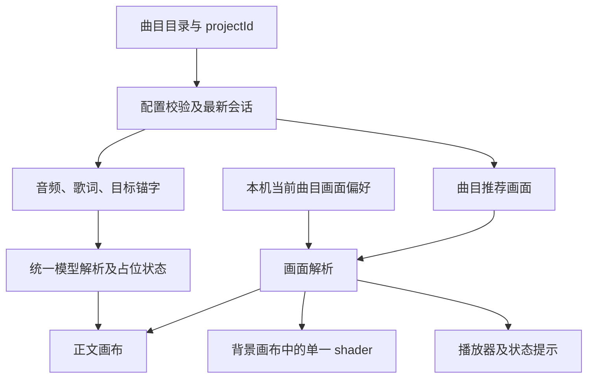

# 曲目切换、画面设置与模型占位方案

日期：2026-10-22。状态：**歌曲、占位、切换及配色已实现并发布，两个公网入口验收通过**。

后续手机迭代按用户要求移除了公开「画面」入口；曲目色系与本机既有选择仍可读取。
本文件保留原设计讨论，当前公开行为以[手机加载与触摸验收](MOBILE_LOADING_TOUCH_RELEASE_20261022.md)为准。

本次正式接入遵循用户最新范围「只是改内容和色系」：保留现有丝绸背景、玉质、排版、两画布和全部手势。
本文的极光与背景类型切换是后续候选设计，不属于本次交付。歌词与音源校对见
[内容核对记录](LOTUS_SUTRA_CONTENT_REVIEW_20261022.md)，发布与性能见[正式验收](LOTUS_SUTRA_RELEASE_20261022.md)。

目标是在现有竖排经文、玉字、丝绸背景与双向无限滚动上接入多首录音，
让歌曲、背景样式和整体色调可分别切换；原始字模型由用户在另一项工作中继续简化，
本项目先用明确标注的占位模型推进内容。

## 1. 设计前调查基线

以下表格记录实施前的调查结果；当前实现见第 9 节。

| 项目 | 调查结果 |
| --- | --- |
| 原始模型 | `/Users/aitoshuu/Downloads/Character/Origin` 中有 101 个 GLB，合计约 1.36 GiB |
| 已有项目资产 | 同字编号中有 26 个对应的项目 OBJ，预计算注册表同样有 26 项；这不证明 Origin 中的 GLB 已验收 |
| 其余字 | 75 个仅有原始 GLB，清单标为用户制作中，并列出已有资产的占位建议 |
| 调查深度 | 读取 GLB JSON 元数据；101 个文件均为一个 Mesh，三角形统计约 25.6 万至 100 万；未做完整几何质量验收 |
| 本曲覆盖 | 《妙法莲华经》简体试稿有 100 种字符，其中 12 字在源模型库中；5 字已有项目 OBJ，7 字待交付 |
| 字模型不等于字体 | 经文仍由字体显示，只有选中的锚字需要 3D 模型；不需要为全文每个字建模 |
| 曲目入口 | 首页仍固定载入 `heart-sutra`，封面仍固定写「心经」 |
| 模型显示 | 预加载使用配置，实际显示另有固定字表；已有的水、山等字也尚未打通到这份显示字表 |
| 背景 | 首页固定使用 SilkR3F；仓库另有 OGL 极光演示组件，不能直接当作同画布背景插件使用 |
| 色彩 | 背景、玉字、文字和进度条仍有硬编码；CSS 主题变量没有覆盖实际 WebGL 画面 |

完整清单见 [101 字模型清单 JSON](model-assets/character-inventory-20261022.json)、
[便于表格查看的 CSV](model-assets/character-inventory-20261022.csv)。清单只记录状态和路径，
**没有复制、简化或导入这 1.36 GiB 原始模型**。

## 2. 模型状态与占位规则

把「源文件存在」「当前有项目资产」「交付已验收」分开记录。用户正在简化的文件不因能读取就自动变成可发布资产。

| 本曲涉及的字 | 当前情况 | 方案中的实际显示模型 |
| --- | --- | --- |
| 心、无、生、法 | 已有项目 OBJ，当前显示字表也支持 | 使用本字 |
| 水 | 已有项目 OBJ，当前显示字表未接通 | 统一解析器接通后使用本字 |
| 妙 | `050_妙.glb`，待用户交付 | 法，占位 |
| 竹 | `073_竹.glb`，待用户交付 | 生，占位 |
| 海 | `027_海.glb`，待用户交付 | 水，占位 |
| 雨 | `032_雨.glb`，待用户交付 | 水，占位 |
| 土 | `083_土.glb`，待用户交付 | 山，占位 |
| 天 | `086_天.glb`，待用户交付 | 空，占位 |
| 化 | `099_化.glb`，待用户交付 | 生，占位 |

以上替代是临时展示，不表示字义或字形相同。其余待交付字先记录统一的「法」模型占位建议，
实际成为某首曲目的锚字时再明确它的映射。佛、莲、华、众、菩、萨目前不在这 101 个文件中；
可继续作普通文字显示，不把额外建模自动追加为用户的制作任务。

### 标注与替换

1. 时间轴始终记目标字，如「竹」，不把它改成占位字「生」。
2. 映射同时记目标字、稳定编号、实际模型路径、实际显示字和占位原因。
3. 正文使用占位时，在播放器附近显示轻量提示，例如「模型制作中：竹（暂用生占位）」。
   状态详情里列出全部待交付字；实际就绪后提示消失。提示不能拦截正文拖动。
4. 字体缺字与模型占位分别标注。本曲字体缺「栴」是字体问题，不用错别字或另一模型掩盖。
5. 用户交付后，先验收字形、尺寸、朝向、完整几何与预计算，再更新映射和状态；录音与歌词时间不必重做。
6. 界面状态必须对应实际正在绘制的模型，不能在下载尚未完成时提前写「就绪」。

### 已增加的兼容字段

保留现有 `anchor` 和 `modelPath` 的含义，`modelPath` 总是指向实际可加载的模型。
`AnchorMapping` 已增加以下可选元数据，类型、Zod 校验与实际读取同步支持：

```ts
characterId?: string;
status?: 'ready' | 'placeholder';
renderedCharacter?: string;
pendingReason?: 'pending-simplification' | 'awaiting-acceptance' | 'not-in-library';
```

当前配置示例：

```json
{
  "anchor": "竹",
  "characterId": "073",
  "modelPath": "019_生.obj",
  "status": "placeholder",
  "renderedCharacter": "生",
  "pendingReason": "pending-simplification"
}
```

统一的 `resolveAnchor(anchor, config)` 返回实际路径与占位状态，供显示、预加载、标签和诊断共用。
移除显示端固定字表后，必须检查默认《心经》的迁移；当前「圆」实际显示「空」，
应先显式记为兼容占位保留既有画面，再单独验收真实「圆」的替换。

本曲的 [15 个拟锚点及占位标注](model-assets/lotus-sutra-zanshi-placeholders.proposed.json)
保留为设计输入；实际发布使用 [正式配置](../public/projects/lotus-sutra-zanshi.json)，不直接加载提案文件。

## 3. 用户如何操作

| 操作 | 桌面与手机的入口 | 行为 |
| --- | --- | --- |
| 切换曲目 | 点击当前标题，打开「经典」面板 | 列出经名、演唱者、录音版本、时长、内容/模型状态；手机用底部面板，桌面用浮层 |
| 背景 | 本次保留丝绸 | 极光及背景类型选择仅为后续候选，本次不新增背景效果 |
| 改整体色调 | 「画面」中的配色预设与「色调」滑杆 | 同步影响背景、玉字、辅助光、经文色温与播放器强调色 |
| 恢复原样 | 「恢复推荐画面」 | 清除当前曲目的本机画面覆盖值，恢复该曲默认背景和配色 |
| 查看占位 | 播放器附近的提示及「经典」面板的状态详情 | 明确目标字与实际显示的占位字 |

面板关闭后保留完整正文空间。操作面板时隔离指针、触摸与键盘事件，防止调色被正文识别为 seek；
支持关闭、返回焦点和 Escape。进度条及现有全部正文手势保留。

### 切歌时的约定

- 首期包含《心经》与赞诗《妙法莲华经》；后续由目录增加独立录音版本。
- 默认入口仍是《心经》；用 `?project=lotus-sutra-zanshi` 这样的稳定 ID 指定曲目。
- 选新曲从第 0 秒开始。原来在播放，则准备完成后尝试播放新曲；原来暂停，则新曲保持暂停。
  加载期间用户新的暂停操作优先。浏览器拒绝自动播放时保留新曲并显示播放入口。
- 准备新曲时保留旧曲可用；新配置、歌词、实际音频时长和初始模型准备成功后一起提交。
  旧音频先停止，再启动新音频，不能同时出声。
- 快速 A→B→C 时只有 C 能提交；旧请求晚到不得覆盖。加载失败明确提示并保留原曲，
  不能把回退《心经》冒充新曲加载成功。
- 切歌重置本曲时间、轮次、惯性、预览和待处理 seek；换背景、换色均不改变这些状态。

## 4. 画面配置与保存

把「内容」与「画面」分开：内容负责录音、歌词与锚点，画面负责背景和颜色。
每首曲目提供推荐画面，用户可独立覆盖。



已增加可选 `appearance`，旧配置未提供时使用当前真实画面的基线值。
当前保留丝绸，配色预设和色调偏移分别存储：

```ts
type AppearanceSettings = {
  background: 'silk';
  palette: 'original-jade' | 'ink-green' | 'warm-gold' | 'violet-gray';
  hueOffset: number; // -180 至 180 度，0 保留预设原色
};
```

四种配色和色调范围已实现。新增 shader 须另行扩展注册表与校验；本次沿用丝绸原有运动参数。

- 配置优先级：应用基线 → 曲目推荐 → 本机该曲目覆盖。
- 本机偏好按曲目 ID 保存，切歌不把一首歌的调色意外覆盖到另一首。
- 首次访问使用该曲推荐画面；刷新恢复本机选择，恢复推荐则删除覆盖值。
- 持久化在操作提交时完成，不在每个动画帧写入存储。

## 5. 后续背景 shader 候选设计（本次范围外）

保持两个画布：**一个背景画布、一个经文与玉字画布**。

1. 背景宿主持续存在，统一持有时钟、分辨率和当前 shader。曲目会话重建不销毁背景宿主。
2. 丝绸首先按原公式、原分辨率和原参数接入，默认画面需做固定帧对照。
3. 极光目前是自行创建 OGL 渲染器的演示组件，需适配为同一背景画布可用的 shader；
   不把整个旧组件叠到丝绸画布上，也不照搬旧组件里的自动降质行为。
4. 新背景先准备好程序，再短暂淡出旧画面、更换、淡入；手机默认不同时完整绘制两套背景。
   过渡由背景宿主管理，不创建第三个 WebGL 画布，不中断音频或正文。
5. 切走释放旧材质及其私有资源，保留共用宿主；快速连点也遵守只有最后一次选择生效。
6. 编译或加载失败时保持上一背景并提示。极光须通过手机与性能验收才列为可用项。

## 6. 整体色相如何真正生效

增加一份解析后的 `ScenePalette`，统一输出背景色/色带、玉字底色、玉字发光色、辅助光色、
当前/邻近经文色与播放器强调色，分别传到实际消费位置。

| 消费端 | 当前阻碍 | 需要做的事 |
| --- | --- | --- |
| SilkR3F | 首页传固定颜色；组件重建 uniforms 时会重置时间 | 颜色更新写入稳定 uniform，保留时间与其它参数 |
| JadeModelLoader | 颜色变化会重建材质；编译助手还把漫反射与发光颜色编成常量 | 仅开放动态颜色绑定，其余物理常量优化、采样及玉质公式保留；拖动色调不反复编译程序 |
| UnifiedLyricsAndModel | 玉字、发光和辅助光有固定色 | 消费同一份已解析配色 |
| LayeredLyricsScene | 初次渲染和逐帧更新都写固定文字颜色 | 两条路径使用同一配色；改色只改材质，不重新生成文字纹理 |
| EnhancedAudioPlayer | 强调色仍为固定浅蓝 | 使用同一配色的强调色 |
| CSS 主题 | 现有变量未覆盖 WebGL | 让 DOM 与 WebGL 消费同一来源，避免只改到按钮 |

当前真实基线包括背景 `#1f2e38`、背景容器 `#202734`、玉字内层 `#2d6d8b`、
内层发光 `#0f2b38`、辅助光 `#4A90E2`、当前文字 `#f8fafc`、邻近文字 `#cbd5f5`、
播放器强调色 `#87CEEB`。旧《心经》JSON 的部分金色主题字段并未用于这些画面，
不能在接线时直接使默认页面突然变金色。

色调偏移为 0 时直接返回原始值，避免颜色换算的舍入误差。各渲染适配器保留原有色彩空间处理：
丝绸当前使用直接归一化 RGB，而 Three 物理材质使用自己的颜色转换，不能集中配置后悄悄改变解释方式。
文字保持浅色和可读对比，只做克制的色温跟随。改色不修改粗糙度、透射、厚度、光照强度或几何。

本方案通过颜色参数生效，不额外增加整屏色相后处理通道；默认画面是否等效、动态颜色是否影响 GPU 耗时均需实际对照。

## 7. 模块与接口边界

| 模块 | 责任及关键接口 |
| --- | --- |
| 曲目目录与选择面板 | 稳定 ID、名称、歌手、录音版本、时长、状态；发出 `selectProject(id)` |
| 会话协调器 | `switchProject(id)`、递增 `sessionRevision`、取消旧请求、原子提交；沿用现有媒体时钟，不建立第二套播放时钟 |
| 内容配置/歌词加载 | 校验请求 ID，支持取消与会话校验；明确失败，不静默错配默认曲目 |
| 正文会话 | 将当前首页中的音频、手势和歌词状态纳入同一会话边界；提交新会话时重置引用和定时器 |
| 模型解析 | `resolveAnchor(anchor, config)`，统一路径、实际显示字、就绪/占位状态 |
| 模型预加载与所有权 | 只准备当前/临近实际模型；占位路径去重；切会话释放引用，防止晚到下载写回与几何缓存持续增长 |
| 画面设置与偏好 | `resolveAppearance(project, overrides)`，校验、恢复默认及按曲目保存 |
| 配色解析 | `resolvePalette(palette, hueOffset)`，生成单一 `ScenePalette` |
| 背景宿主/注册表 | 单一背景画布、稳定时钟、准备/切换/释放背景程序 |

实现时涉及首页及封面、ProjectConfig 类型与校验、项目状态和歌词加载、播放器、统一场景、
模型预加载/显示、文字材质、SilkR3F、极光适配，以及物理材质编译助手。
现有 `onSeek`、音频时间回调和无限时间轴语义保持兼容。

## 8. 验收与推进顺序

1. **模型数据**：101 个稳定编号无重复；75 个制作中状态可追踪；每个占位路径存在；
   页面显示与标注一致，交付后只替换映射，不重做歌词；Origin 文件保持未修改。
2. **两首曲目**：心经与赞诗录音的 URL、标题、音频、歌词、锚点全部对应；
   快速 A→B→A、加载失败、加载时暂停不会串曲；第一次进入正确显示实际曲名。
3. **无限滚动**：两曲分别验证正反多轮、自然循环、快速定位、暂停恢复、鼠标和触摸手势；
   实际时长仍取媒体元数据。
4. **外观独立**：播放中反复切配色、拖动色调，不跳时间、不重置模型旋转或丝绸时钟；
   恢复推荐及刷新持久化行为明确。
5. **画面保持**：默认丝绸与玉字按固定姿态对照；前后字号、遮挡、透明度、羽化、完整模型及字体保留。
   歌词的「栴」字、各曲前奏与间奏时间另做内容验收。
6. **资源与性能**：任意外观均只有两个画布；往返切曲、调色后资源有界；
   ego-lite 手机模拟正常/压力各 60 秒，单独记录切换长帧、程序编译与纹理生成；
   与同环境当前基线比较，不能把短时约 30 FPS 的试载当作新功能性能验收。
7. **交付**：先完成本地两曲与占位、再完成外观控制、最后合并回归。
   commit/push、发布的范围按用户对实施与交付的明确授权执行；本设计稿不自动启动代码修改或上线。

## 9. 本轮已落地与未实施

已落地：两首正式内容与目录、标题切换入口、统一模型解析与占位提示、可取消且只提交最新结果的会话准备、
持久音频元素与两画布、按曲目保存的四套配色及色调、动态玉色、字体「栴」补字、闲置模型最多 8 项的回收。
原始文件元数据清单、75 字制作中状态与候选占位数据仍保留供后续模型交付使用。

极光与背景类型切换不属于用户本次「内容和色系」范围，保留为候选设计；原始 GLB 仍待用户在隔壁完成简化和验收。
本地与公网的实际测试结果按发布记录为准，不把设计目标当成已验证结果。

## 10. 调查依据

- [已有经典接入规范](CLASSICS_INTEGRATION_SPEC.md)。
- [项目配置类型](../src/config/types.ts)、[校验规则](../src/config/schema.ts)、[配置加载](../src/config/loader.ts)。
- [首页](../src/app/page.tsx)、[封面](../src/components/AutoPlayGuard.tsx)、[播放器](../src/components/audio/EnhancedAudioPlayer.tsx)。
- [统一场景](../src/components/layouts/UnifiedLyricsAndModel.tsx)、[文字场景](../src/components/layouts/LayeredLyricsScene.tsx)。
- [丝绸背景](../src/components/backgrounds/SilkR3F.tsx)、[现有极光演示](../src/components/backgrounds/AuroraBackground.tsx)。
- [玉字材质](../src/components/jade/JadeModelLoader.tsx)、[材质编译](../src/components/jade/specializePhysicalMaterial.ts)。
- [模型预加载](../src/components/jade/ModelPreloader.ts)、[预计算注册表](../src/components/jade/prepared-models.json)。
